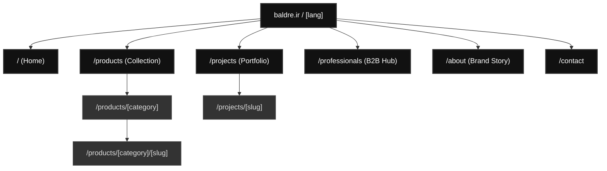

# SEO-Optimized Site Tree Map Plan

## Goal Description
The objective is to design a high-tech, modern, and minimal Site Tree Map for Baldre Lighting. The structure must be heavily optimized for Search Engine Optimization (SEO) to capture both local Iranian traffic (Farsi) and international B2B clients (English), while maintaining the uncluttered, ultra-minimal UX expected of a luxury lighting brand.

## Visual Site Architecture (Mermaid)

---

## The URL Structure & SEO Strategy

To achieve a "high-tech" SEO foundation, we will use **Semantic Siloing** via the Next.js App Router (`app/[lang]/...`). This means the URL structure explicitly tells Google how products relate to each other.

### 1. Bilingual Routing Strategy
*   **English:** `baldre.ir/en/...`
*   **Farsi:** `baldre.ir/fa/...`
*   *SEO Tech:* We will implement `hreflang` tags in the Next.js `<head>` so Google understands exactly which language version to serve to which user, preventing duplicate content penalties.

### 2. The Core Navigation (The Minimal UI)
To keep the design minimal (like Davide Groppi), the actual navigation menu will only show 3 or 4 primary links. 
1.  **Collection** (`/products`) - Shows the 300+ products.
2.  **Projects** (`/projects`) - Shows real-world architectural applications of the lights.
3.  **Professionals** (`/professionals`) - A dedicated hub for architects.
4.  **About / Contact** (`/about`, `/contact`)

### 3. Deep Dive: SEO Product Silos
Instead of throwing 300 products into one folder, we silo them logically:
*   `baldre.ir/fa/products/` (All products - High competition keyword: خرید چراغ)
*   `baldre.ir/fa/products/pendant/` (Category Hub - Target keyword: چراغ آویز مدرن)
*   `baldre.ir/fa/products/pendant/linear-suspension-01` (Product Detail)
*   *SEO Tech:* Each product page will feature **JSON-LD Schema Markup** (`Product` and `BreadcrumbList`). Even though there is no price, we will mark it up as a B2B catalog item so Google can extract the image, brand, and specifications directly into search results.

### 4. The "Professionals" Hub (B2B SEO)
*   `baldre.ir/en/professionals/`
*   *Why?* Architects don't search for "buy lamp". They search for "Linear pendant IES file" or "Magnetic track light CAD model". By creating a dedicated page targeting B2B keywords and offering bulk downloads of our PDFs, CADs, and IES files, we capture highly lucrative architectural traffic.

---

## User Review Required

> [!IMPORTANT]
> **Navigation UI Strategy**
> To keep the site "ultra-minimalist", how do you want the user to open this sitemap?
> 1. **The Classic Top Bar:** Links are always visible at the top (easier for users, slightly less minimal).
> 2. **The Hidden Hamburger (Recommended for Luxury):** The top bar only has the Baldre Logo and a `[ = ]` menu icon. Clicking it opens a beautiful, full-screen overlay with the site tree. (See: Foscarini, Flos).

## Open Questions

> [!WARNING]
> 1. **Domain Strategy:** Are we strictly using `baldre.ir`, or do you also own `baldre.com` / `baldre.lighting` for the English international audience?
> 2. **Categorization:** Do you currently categorize your products by **Mounting Type** (Pendant, Floor, Wall) or by **Environment** (Indoor, Outdoor, Office)? (We need to pick one primary method for the URLs).
